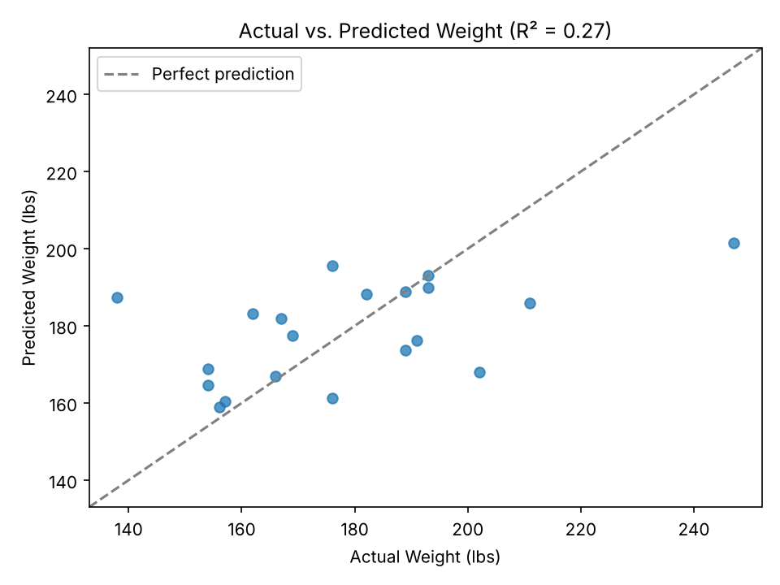
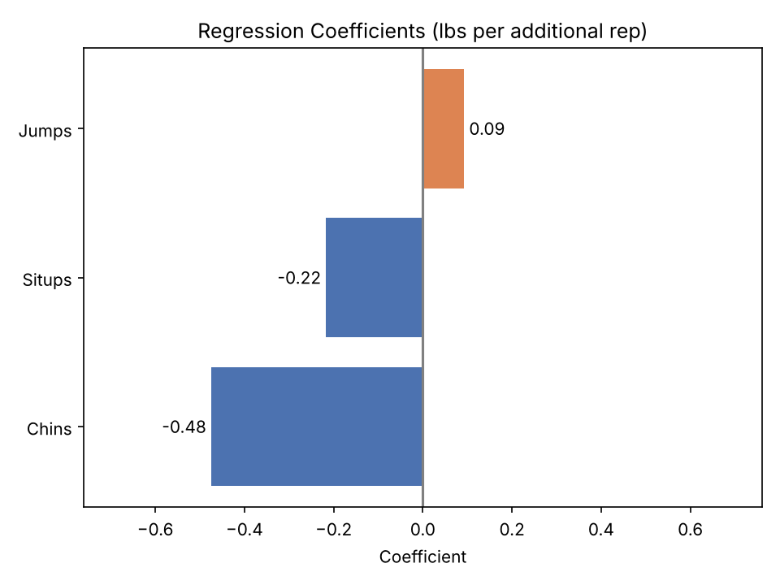
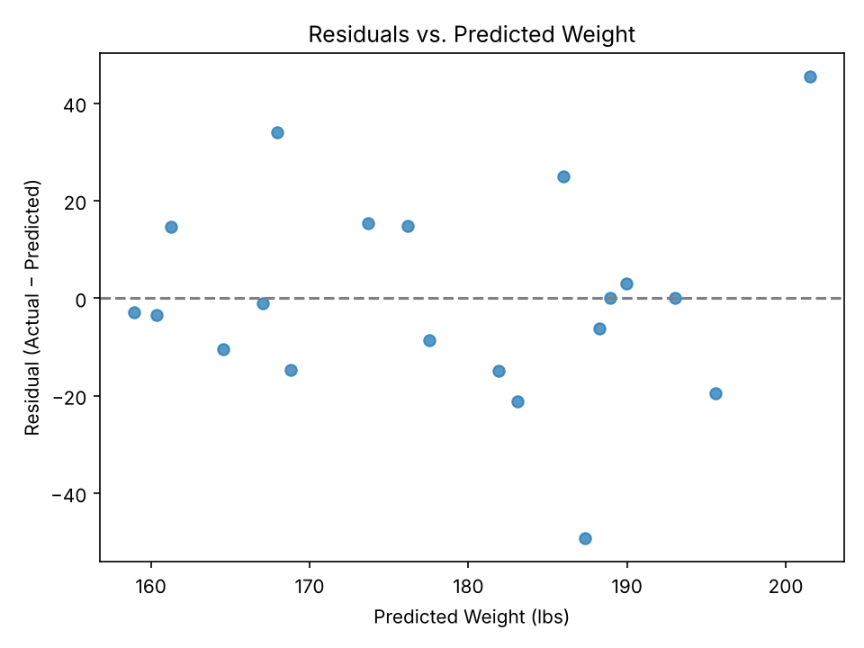

# Evaluating Regression Models with MSE and R² 💪

This repository contains a supervised machine learning exercise that trains a multiple linear regression model on the Linnerud dataset and evaluates it with standard regression metrics. The focus is on interpretation: what MSE and R² actually tell you, and what they don't.

---

## Project Overview 🏋️‍♂️

The Linnerud dataset, included in scikit-learn, records exercise performance and physiological measurements for 20 middle-aged men at a fitness club.

- 🏃**Features (exercise):** Chins (chin-ups), Situps, Jumps 
- ⚖️**Target:** Weight (lbs) 

A linear regression model was trained on all three exercise features to predict weight. It was then evaluated with:

- **Mean Squared Error (MSE):** the average squared difference between actual and predicted values
- **Root Mean Squared Error (RMSE):** the square root of MSE, in the target's original units (lbs)
- **R² (coefficient of determination):** the proportion of variance in weight explained by the model

---

## Key Findings 🔎

- **R² = 0.27:** The model explains about **27%** of the variance in weight. The remaining **73%** comes from factors the model does not capture, such as height, diet, or body composition.
- **MSE = 423.98:** Because MSE is in *squared* pounds, it is hard to read directly.
- **RMSE ≈ 20.6 lbs:** On average, predictions miss actual weight by about 20 lbs. Weights in the data average 178.6 lbs with a standard deviation of about 24 lbs, so the model is only slightly better than guessing the mean.
- **Exercise is inversely related to weight:** More chin-ups and sit-ups are associated with lower weight. Sit-ups have the strongest single relationship (r = −0.49).

---

## Models and Performance 🔬

| Metric | Value |
|---|---|
| R² (training data) | 0.268 |
| MSE | 423.98 |
| RMSE | 20.59 lbs |
| MAE | 15.25 lbs |

**Regression coefficients** (change in predicted weight per additional rep, holding other features constant):

| Feature | Coefficient |
|---|---|
| Intercept | 208.23 |
| Chins | −0.48 |
| Situps | −0.22 |
| Jumps | +0.09 |

The coefficient for Jumps is slightly positive even though Jumps correlates negatively with weight on its own (r = −0.23). This happens because the three exercise features overlap: once Chins and Situps are in the model, Jumps adds little independent information.

---

## Key Takeaways #️⃣

**1. These metrics are measured on the training data.**
The model was evaluated on the same 20 records it learned from, so the results are optimistic. A leave-one-out cross-validation check produced an R² of **−0.34** and an RMSE of **27.8 lbs**. A negative R² means the model predicts new data *worse* than simply using the average weight. With only 20 observations and three features, the model is fitting noise.

**2. Report RMSE alongside MSE.**
MSE is useful for optimizing models but is hard to explain to stakeholders. RMSE puts error back into pounds, which makes it easy to compare against the spread of the data.

**3. A low R² is not automatically a failure, but context matters.**
Exercise performance was never likely to explain most of the variation in body weight. The model is reasonable as a learning exercise, but it should not be used to make predictions about individuals.

**4. Residuals show the model struggles at the extremes.**
The largest error is about 49 lbs. The model pulls predictions toward the middle, underestimating the heaviest participants and overestimating the lightest.

---

## Repository Contents 📁

| File | Description |
|---|---|
| `regression_metrics_starter.ipynb` | Jupyter notebook with data loading, model training, and metric calculations |
| `situps-vs-weight.png` | Scatterplot of sit-ups vs. weight |
| `actual-vs-predicted.png` | Actual vs. predicted weight with a perfect-prediction reference line |
| `residual-plot.png` | Residuals vs. predicted values |
| `regression-coefficients.png` | Bar chart of the model's coefficients |
| `README.md` | Project documentation |

---

## Model Evolution 🧬

1. **Exploration:** Visualized the relationship between sit-ups and weight
2. **Training:** Fit a multiple linear regression model on all three exercise features
3. **Evaluation:** Calculated MSE and R² with scikit-learn's `mean_squared_error` and `r2_score`
4. **Interpretation:** Added RMSE, MAE, coefficient analysis, residuals, and a cross-validation check to put the metrics in context

---

## Future Work 🔭

- Evaluate on held-out data using cross-validation as the primary metric rather than training-set performance
- Compare single-feature models (Situps alone reaches R² = 0.24, nearly matching the full model)
- Try regularized regression (Ridge, Lasso) to handle overlap among the exercise features
- Model the other physiological targets (Waist, Pulse) and compare how well exercise predicts each
- Apply the same evaluation approach to a larger fitness or health dataset where results would generalize

---

## Contact Information

**Melissa Slawsky**
[Add your LinkedIn / email / portfolio links here]

---

## Disclaimer

This project was completed as part of the [Udacity Data Science Nanodegree](https://www.udacity.com/course/data-scientist-nanodegree--nd025) program. The Linnerud dataset is publicly available through scikit-learn, and the exercise structure was provided by Udacity. All analysis, interpretation, and documentation are my own.

---

© Melissa Slawsky 2026. All Rights Reserved.
